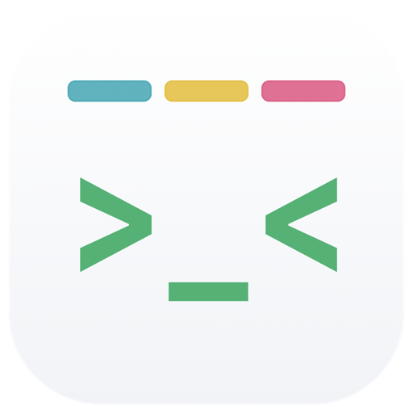
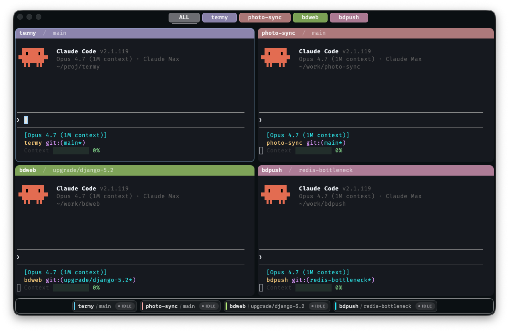
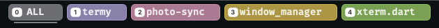
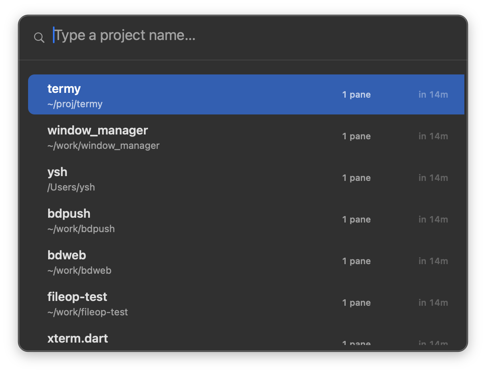
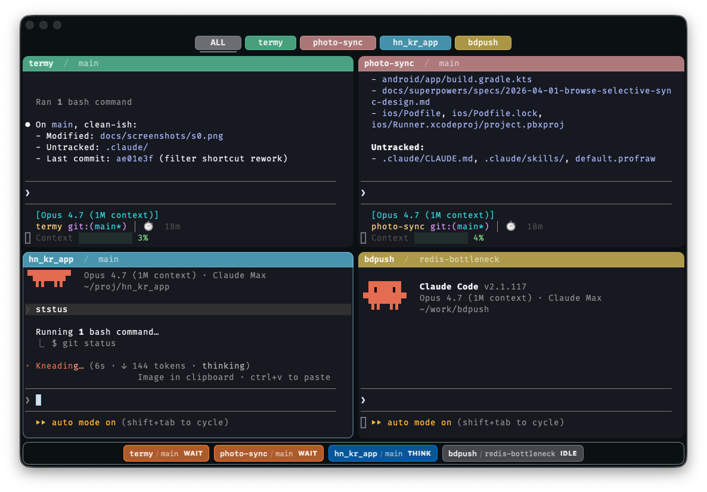
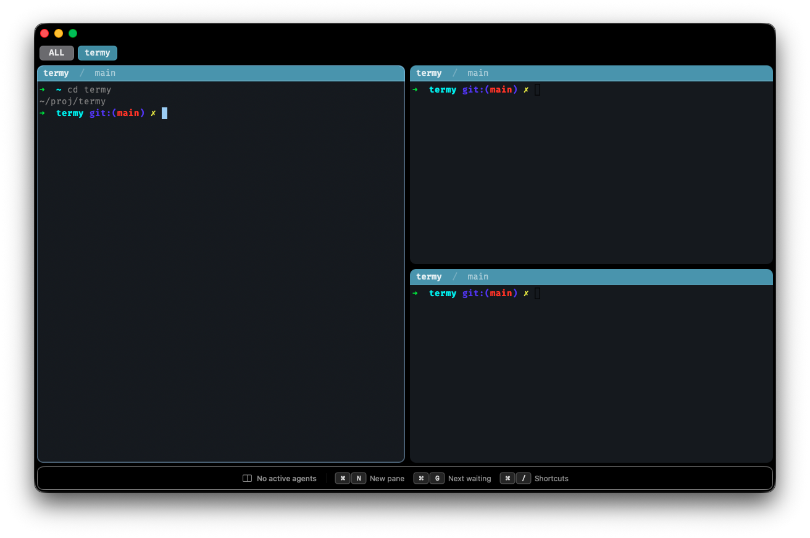
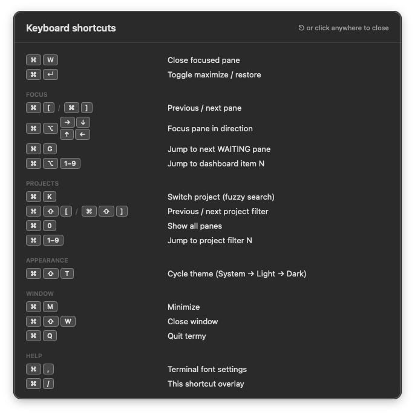
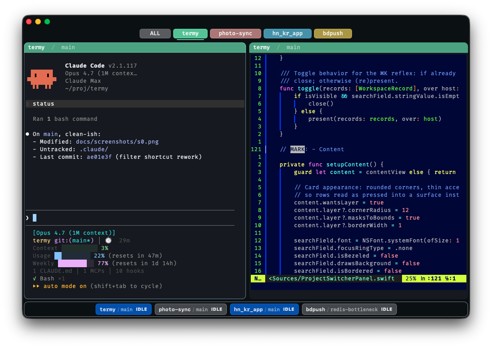

<p align="center">
  
</p>

<h1 align="center">termy</h1>

<p align="center"><strong>Mission control for Claude Code, Codex, OpenCode &amp; Antigravity.</strong></p>

<p align="center">
  A native macOS terminal for running coding agents side by side —<br/>
  with live per-agent state, project-aware panes, rendered Markdown &amp; PDF previews,<br/>
  and updates that don't end your sessions.
</p>

<p align="center">
  <a href="https://github.com/yeonsh/termy/releases/latest">Download for macOS</a> ·
  <a href="https://termy.nugo.cc/">termy.nugo.cc</a> · macOS 14+
</p>

<p align="center">
  
</p>

<p align="center">
  <em>Press <kbd>⌘</kbd><kbd>G</kbd> to jump straight to the next <b>WAIT</b> agent.</em>
</p>

---

## Why termy

Running N coding agents — Claude Code, Codex CLI, OpenCode, Antigravity CLI, or
any mix — in a stock terminal turns into tab roulette: which session is blocked
on a permission prompt, which is mid-tool, which already finished? You end up
Cmd-Tabbing through windows, scanning panes, and missing the one that was
waiting on you five minutes ago.

**termy pulls that state out of the panes and into a glanceable dashboard.**
Every running agent gets a chip at the bottom of the window with its live
status: `IDLE`, `THINK`, `WAIT`, or `ERR`. When an agent needs permission or
input, macOS notifies you — even when termy is in the background. One keystroke
takes you there.

## Projects, not tabs

Other terminals give you tabs. termy gives you **projects**.

Every pane belongs to a project (its cwd), and the top filter bar shows one
pill per project. Click `termy` to see only the `termy` panes. Click `ALL` to
see everything. Same project → same jewel-tone accent everywhere — pane header,
dashboard chip, filter pill — so a four-agent window stops looking like a soup
of identical black rectangles.

Drag the titlebar chips to put projects in your order. The same order drives
<kbd>⌘</kbd><kbd>1</kbd>–<kbd>⌘</kbd><kbd>9</kbd>, the ALL view, and focus
order. ALL packs every pane into one even grid with each project's panes kept
together, while a single project keeps the split layout you built.

<p align="center">
  
</p>

**Hold <kbd>⌘</kbd>** and a number appears on every filter pill. Press the
number — you're there. <kbd>⌘</kbd><kbd>0</kbd> is always *All*;
<kbd>⌘</kbd><kbd>1</kbd>–<kbd>⌘</kbd><kbd>9</kbd> jump straight to that
project's pane grid. <kbd>⌘</kbd><kbd>⇧</kbd><kbd>[</kbd> and
<kbd>⌘</kbd><kbd>⇧</kbd><kbd>]</kbd> walk the filters in order.

Prefer names? <kbd>⌘</kbd><kbd>K</kbd> opens a fuzzy project switcher over
every project termy has seen, with pane counts and "last used" timestamps.
Picking one restores that project's saved pane grid. Renamed or deleted a
project folder? The trash button at the end of its row (or
<kbd>⌘</kbd><kbd>⌫</kbd> with an empty search) removes it from the list; the
folder itself is never touched.

<p align="center">
  
</p>

## A dashboard for every agent

The strip along the bottom of the window is one chip per running agent —
Claude Code, Codex CLI, OpenCode, or Antigravity CLI, mixed freely. Each chip
shows **project / branch** and a live state. While an agent works, a bar in the
project's color slides along that pane's header.

<p align="center">
  
</p>

- **`IDLE`** — agent is at the prompt, nothing running.
- **`THINK`** — a tool call is in flight. The model is doing work.
- **`WAIT`** — blocked on a permission prompt or a question. Your attention needed.
- **`ERR`** — the agent or its shell exited with an error. The chip stays red until you look.
- **`INIT`** — a fresh pane, until the agent reports its first event.

<kbd>⌘</kbd><kbd>G</kbd> jumps to the next `WAIT` pane, wherever it is —
across splits, across project filters, across windows. The single most useful
keystroke in the app. <kbd>⌘</kbd><kbd>⌥</kbd><kbd>G</kbd> walks every
dashboard chip in order.

**Hold <kbd>⌘</kbd><kbd>⌥</kbd>** and a number appears on each dashboard
chip; press the number to focus that pane directly, even if it's in a
different project filter.

Open several windows and each strip shows the chips for **every window at
once**. Click a chip — or tap a `WAIT` notification — and termy brings the
owning window forward and focuses the right pane.

## Files, rendered

<kbd>⌘</kbd>-click a Markdown or PDF path in any pane — a spec an agent just
wrote, a plan, a generated report — and termy opens it in its own preview
window. Drop a Markdown or PDF file on a Markdown preview window to do the
same. Previews follow your light or dark appearance and update live as the
agent writes. PDF links inside a Markdown preview, and `file://` links to
PDFs, open there too — even when the filename has spaces or parentheses.

- **Markdown, live.** Tables, task lists, and code blocks look the way they do
  on GitHub. When an agent edits the file, the preview updates in place and
  keeps your scroll position. <kbd>⌘</kbd><kbd>W</kbd> closes the preview
  without touching your panes.
- **PDF, live.** Open a PDF path the same way. A regenerated file updates the
  preview while keeping the page and zoom you were reading; a half-written
  file leaves the previous version on screen.
- **Show in Finder.** <kbd>⌥</kbd><kbd>⌘</kbd><kbd>R</kbd>, or right-click the
  preview, opens the file's folder with the file selected.

## See it in action

<table>
  <tr>
    <td width="50%" align="center">
      <br/>
      <sub><b>State shows up everywhere.</b> Pane border, sliding header activity bar, dashboard chip, and a macOS notification — driven by each agent's own hooks and plugins.</sub>
    </td>
    <td width="50%" align="center">
      <br/>
      <sub><b>Splits, not tabs.</b> Nested <code>NSSplitView</code>s. Drag to resize. <kbd>⌘</kbd><kbd>T</kbd> adds a pane (auto-orients on aspect ratio), <kbd>⌘</kbd><kbd>D</kbd> splits the current row, <kbd>⇧</kbd><kbd>⌘</kbd><kbd>D</kbd> adds a new row.</sub>
    </td>
  </tr>
  <tr>
    <td width="50%" align="center">
      <br/>
      <sub><b><kbd>⌘</kbd><kbd>/</kbd> reveals everything.</b> The full shortcut map — panes, focus, projects, appearance, window. No hidden bindings.</sub>
    </td>
    <td width="50%" align="center">
      <br/>
      <sub><b>Lives next to your editor.</b> Light, Dark, or Match System — <em>View → Appearance</em> or <kbd>⌘</kbd><kbd>⇧</kbd><kbd>T</kbd> switches terminal, chrome, and dashboard together. <kbd>⌘</kbd><kbd>,</kbd> picks the terminal font, Korean fallback, and size.</sub>
    </td>
  </tr>
</table>

## What else you get

- **Four agents, one dashboard.** Claude Code, Codex CLI, OpenCode, and
  Antigravity CLI — mixed freely in the same window. Each integration installs
  from the termy menu and reports live state through hooks or a plugin. A
  `WAIT` flip pings macOS even when termy is in the background.
- **Workspace that survives.** Splits, project grouping, and cwd are all
  persisted per project. Pick a project in <kbd>⌘</kbd><kbd>K</kbd> and termy
  rebuilds the pane grid you left it in.
- **Updates that wait for you.** *Install and Relaunch* waits while an agent is
  mid-turn, then restarts once every agent has finished. Claude Code, Codex,
  and Antigravity conversations reopen in place (`claude --resume`,
  `codex resume`, `agy --conversation`), flags included. In a hurry, choose
  <kbd>termy</kbd> ▸ *Restart Now to Install Update*.
- **One window per monitor.** <kbd>⌘</kbd><kbd>N</kbd> opens an independent
  window — its own pane grid, project filter, and split behaviour.
- **Quit and come back.** Relaunch and every window returns — frames,
  positions, pane layouts, and project filters. A window stranded off-screen is
  clamped back onto a visible display.
- **Real splits.** <kbd>⌘</kbd><kbd>T</kbd> new pane, <kbd>⌘</kbd><kbd>D</kbd>
  same-row split, <kbd>⇧</kbd><kbd>⌘</kbd><kbd>D</kbd> new-row split. Drag the
  dividers. <kbd>⌘</kbd><kbd>⏎</kbd> toggles maximize.
- **Input that stays out of your way.** Drop files from Finder onto a pane and
  termy types the absolute paths, escaped and ready for zsh. <kbd>⇧</kbd><kbd>⏎</kbd>
  inserts a newline in Claude Code instead of submitting the prompt.
- **Real mouse apps.** Clicks and drags go to apps that use the mouse — Claude
  Code fullscreen, tmux, vim — the way Ghostty and iTerm2 do. Hold
  <kbd>⇧</kbd> to select with termy instead, and the selection survives
  scrolling.
- **Scrolling that follows your fingers.** Trackpad scrolling moves by the
  distance you swipe, with Ghostty-style momentum; a mouse wheel moves three
  rows a notch. Scrollback stops snapping to the bottom while you read, and
  follows again once you scroll back down. Tune the speed with
  `termy.scrollSensitivity`.
- **Fonts, themes & Korean input.** Pick a monospaced font, a Korean fallback,
  and a size — changes apply live. <kbd>⌘</kbd><kbd>⇧</kbd><kbd>T</kbd> cycles
  System / Light / Dark. Korean IME composition and circled numbers like ①②③
  no longer cover the line.
- **Projects in your order.** Drag titlebar chips to reorder projects; the
  order drives <kbd>⌘</kbd><kbd>1</kbd>–<kbd>⌘</kbd><kbd>9</kbd>, the ALL view,
  and focus order. Remove folders you renamed or deleted from the
  <kbd>⌘</kbd><kbd>K</kbd> list — the folder itself is never touched.
- **Native, not Electron.** AppKit + SwiftTerm. A signed, notarized DMG, real
  `UserNotifications`, Full Disk Access, titlebar chrome — and Sparkle updates
  that verify every build.

## Agent integrations

Each installer is non-destructive: termy owns only its own keys or file,
preserves the hooks and plugins you already have, and backs up any existing
configuration file before changing it. Move the app and the next launch
re-registers the new hook path. You can uninstall any integration from the
<kbd>termy</kbd> menu without touching your own configuration.

### Claude Code hooks

First launch asks once — *"Install termy hooks into Claude Code?"* — and the
app merges its entries into `~/.claude/settings.json`, preserving any hooks
you already have. Every entry is tagged `_termy_managed: true` so uninstall
is surgical, and the previous file is backed up to
`settings.json.backup-<ts>` before any write.

- **If you move the app**, the next launch detects the stale path and
  silently re-registers against the new location.
- **To uninstall**, use the <kbd>termy</kbd> menu → *Claude Code Hooks…* →
  *Uninstall*. Your own hooks are untouched.
- **`termy-hook`** always exits `0` and write-timeouts after 100 ms — it
  cannot stall Claude Code even if termy isn't running.
- **Permission, question, and MCP-tool approvals** all flip the pane to
  `WAIT` and trigger the macOS notification.

### Codex CLI hooks

Codex CLI is supported via the same `termy-hook` binary. If
`~/.codex/hooks.json` exists, termy writes its hook entries there; otherwise
it uses `~/.codex/config.toml`. Either way it enables `[features] hooks = true`.
Blocks are tagged `_termy_managed = true`, your other hooks and feature
settings are preserved, and the files it changes are backed up before a write.

If termy detects a Codex install (it probes `~/.codex` and the common
Homebrew / npm / cargo / mise / asdf install paths), it will offer to install
the integration on first launch; otherwise opt in any time via
<kbd>termy</kbd> menu → *Codex Hooks…*

Mappings (per `developers.openai.com/codex/hooks`):

| Codex event | Pane state |
|---|---|
| `SessionStart` | hard reset to `IDLE` |
| `PreToolUse` / `PostToolUse` | `THINK` |
| **`PermissionRequest`** | **`WAIT`** + macOS notification |
| `Stop` | `IDLE` after 30 s |

Codex has no native `SessionEnd` hook; termy synthesizes one by watching
the foreground process group of each pane's PTY (`tcgetpgrp` + libproc).
Once `codex` leaves the foreground (`/exit`, Ctrl-C), the chip resets to
neutral `INIT` automatically — even though no hook fired.

#### Caveat: Codex hooks don't cover every state transition

Claude Code exposes a complete state-tracking surface: `Notification` fires
the moment Claude stops to ask for input, and `Stop` fires when the agent
finishes a turn. Codex's hook surface is narrower. There's no
`Notification`-equivalent — `PermissionRequest` fires only for explicit
permission asks, not the general "I'm waiting on you" pauses that reasoning
models (GPT-5, o-series) lean on. Result: a Codex pane can sit silent at a
`>` prompt with no hook ever firing.

termy fills the gap with a two-stage silence detector: ~8 s of PTY quiet
moves the chip to a silent `POSSIBLY_WAITING` (visual only, no sound), and
~12 s of further quiet promotes it to `WAITING` (chip + macOS notification).
Any byte from the PTY reverts the silent state instantly. The trade-off:
Codex `WAIT` lands ~20 s after the agent actually paused rather than
instantly, and the false-positive rate isn't zero. If Codex ships a
`Notification`-equivalent in future, termy will switch to it and drop the
heuristic.

### OpenCode plugin

OpenCode talks to termy through a small TUI plugin instead of hooks.
<kbd>termy</kbd> menu → *OpenCode Plugin…* installs exactly one file,
`~/.config/opencode/plugins/termy/tui.js`, and never edits `opencode.json`.

The plugin watches the routed root session's permission, question, and busy
flags plus its execution outcome, and reports transitions. termy maps them to
`IDLE`, `THINK`, `WAIT`, and `ERR`. OpenCode sessions that are already open
pick it up right away. Uninstall removes termy's file and keeps other plugins
in place.

### Antigravity hooks

Antigravity CLI (`agy`) loads global hooks from
`~/.gemini/config/hooks.json`. termy owns a single top-level `"termy"` group;
your other hook groups stay untouched, and the previous file is backed up
before a write. Install or remove it from <kbd>termy</kbd> menu →
*Antigravity Hooks…*

The hooks report the same `IDLE`, `THINK`, `WAIT`, and `ERR` states, and let
termy reopen the same conversation with `agy --conversation` after an update.

## Keyboard cheatsheet

| | |
|---|---|
| <kbd>⌘</kbd><kbd>G</kbd> | **Jump to next `WAIT` pane** |
| <kbd>⌘</kbd><kbd>⌥</kbd><kbd>G</kbd> | Jump to the next dashboard chip |
| <kbd>⌘</kbd><kbd>⌥</kbd><kbd>1</kbd>–<kbd>9</kbd> | Jump to dashboard chip N (hold <kbd>⌘</kbd><kbd>⌥</kbd> to see numbers) |
| <kbd>⌘</kbd><kbd>0</kbd> | Show all projects |
| <kbd>⌘</kbd><kbd>1</kbd>–<kbd>9</kbd> | Jump to project filter N (hold <kbd>⌘</kbd> to see numbers) |
| <kbd>⌘</kbd><kbd>⇧</kbd><kbd>[</kbd> / <kbd>⌘</kbd><kbd>⇧</kbd><kbd>]</kbd> | Previous / next project filter |
| <kbd>⌘</kbd><kbd>K</kbd> | Fuzzy project switcher |
| <kbd>⌘</kbd><kbd>⌫</kbd> | In <kbd>⌘</kbd><kbd>K</kbd>, remove the selected project from the list |
| <kbd>⌘</kbd><kbd>[</kbd> / <kbd>⌘</kbd><kbd>]</kbd> | Previous / next pane |
| <kbd>⌘</kbd><kbd>⌥</kbd><kbd>←↑↓→</kbd> | Focus pane in direction |
| <kbd>⌘</kbd><kbd>D</kbd> / <kbd>⇧</kbd><kbd>⌘</kbd><kbd>D</kbd> | Same-row / new-row split |
| <kbd>⌘</kbd><kbd>T</kbd> | New pane — auto-splits, picks row/column from aspect ratio |
| <kbd>⌘</kbd><kbd>N</kbd> | New window — its own pane grid, project filter, and splits |
| <kbd>⌘</kbd><kbd>⏎</kbd> | Toggle maximize on the focused pane |
| <kbd>⌘</kbd><kbd>W</kbd> | Close focused pane (or the current preview) |
| <kbd>⌘</kbd><kbd>⇧</kbd><kbd>W</kbd> | Close window |
| <kbd>⌘</kbd><kbd>⇧</kbd><kbd>T</kbd> | Cycle theme — System → Light → Dark |
| <kbd>⌘</kbd><kbd>+</kbd> / <kbd>⌘</kbd><kbd>−</kbd> | Increase / decrease terminal font size |
| <kbd>⌘</kbd><kbd>,</kbd> | Terminal font settings |
| <kbd>⌥</kbd><kbd>⌘</kbd><kbd>R</kbd> | Show the previewed file in Finder |
| <kbd>⌘</kbd><kbd>/</kbd> | Full shortcut overlay |

## How it works

```
Claude Code ──hook───▶ termy-hook --agent claude-code ─┐
Codex CLI   ──hook───▶ termy-hook --agent codex       ─┤
OpenCode    ──plugin─▶ termy-hook --agent opencode    ─┼─ unix socket ─▶ HookDaemon (in-app actor)
Antigravity ──hook───▶ termy-hook --agent antigravity ─┘                        │
                                                                                ▼
                                                                       ┌─────────────────┐
                                                                       ▼                 ▼
                                                                PaneStateMachine    fg-process watcher
                                                                       │              (synthetic SessionStart/End)
                                                                       ▼
                                                     MissionControlView + Notifier
```

- **SwiftTerm** renders the PTY and owns the child shell lifecycle.
- **`termy-hook`** is a tiny Swift CLI that Claude Code, Codex, and
  Antigravity invoke per hook event; OpenCode's plugin spawns it too. It
  slims the payload and sends one JSON line over `/tmp/termy-$UID.sock`.
  It always exits `0` and times out writes after 100 ms, so it cannot stall
  an agent.
- **`HookDaemon`** is an actor that receives those events. They flow through
  **`PaneStateMachine`**, the pure reducer covered by 670+ unit tests —
  including Claude Code's permission, question, and MCP-tool approval events.
- **OpenCode plugin.** A small `tui.js` watches the active session's
  permission, question, and busy flags and reports transitions; termy maps
  them to `IDLE`, `THINK`, `WAIT`, and `ERR`.
- **Antigravity hooks.** Installed into `~/.gemini/config/hooks.json`, they
  report the same states and let termy reopen the same conversation with
  `agy --conversation` after an update.
- **Every installer is non-destructive.** termy owns only its own keys or
  file, backs up configuration before changing it, and uninstalls from the
  <kbd>termy</kbd> menu without touching your own hooks.
- **Synthetic `PtyExit`** fills the gap hooks can't — hard crashes (Ctrl+C
  mid-response, SIGKILL) fire no hook, so termy emits a synthetic event on
  PTY EOF. A 1 Hz foreground-process watcher does the same when `claude`,
  `codex`, `opencode`, or `agy` leaves a pane.
- **Codex hook coverage caveat.** Claude Code emits a `Notification` hook the
  moment it stops for input; Codex doesn't. `PermissionRequest` only fires
  for explicit asks, not the general "I'm waiting on you" pauses reasoning
  models lean on. termy fills the gap with a two-stage silence detector
  (~8 s → silent `POSSIBLY_WAITING`, ~12 s → `WAITING` + sound). Trade-off:
  Codex `WAIT` lands ~20 s after the agent paused, not instantly.

## Status

Shipping. The core loop is working end-to-end:

- Four agents end-to-end — Claude Code, Codex CLI, OpenCode, and Antigravity CLI
- Live dashboard with `THINK` / `WAIT` / `IDLE` / `ERR`, notifications, and
  <kbd>⌘</kbd><kbd>G</kbd> navigation
- SwiftTerm panes with OSC 7 cwd tracking, splits, mouse-aware TUIs, and
  <kbd>⌘</kbd>-click URLs
- Markdown and PDF previews with live updates, drag-to-open, and Show in Finder
- Hook daemon + `termy-hook` + non-destructive installers for every integration
- Workspace autosave, multi-window dashboard, and full session restore
- Project chips you can reorder and prune, per-project accents, and
  <kbd>⌘</kbd><kbd>1</kbd>–<kbd>⌘</kbd><kbd>9</kbd> filters
- Sparkle auto-update that waits for running agents and resumes their
  conversations
- Developer ID-signed, notarized DMG pipeline and 670+ unit tests

## Still on the list

See `TODOS.md` for deferred work — screen-scraping fallback for agents without
hooks, a separate LaunchAgent daemon, user-editable hook config, and a
per-project settings UI.

## Internals

- `docs/project-overview.md` — architecture, runtime, hook system constraints
- `docs/auto-update.md` — Sparkle release and update runbook
- `TODOS.md` — scoped-out work with reasoning
- `apps/termy/Sources/` — the app
- `apps/termy-hook/Sources/` — the hook helper CLI
- `apps/termy-tests/Sources/` — 670+ tests across 50+ suites
